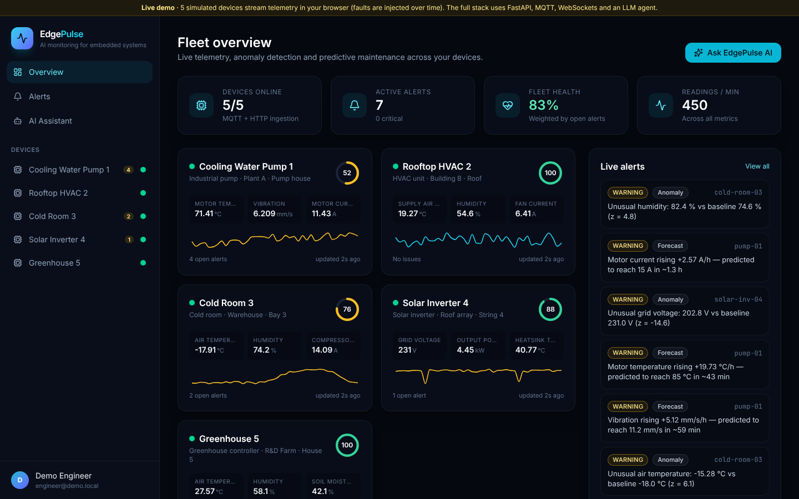
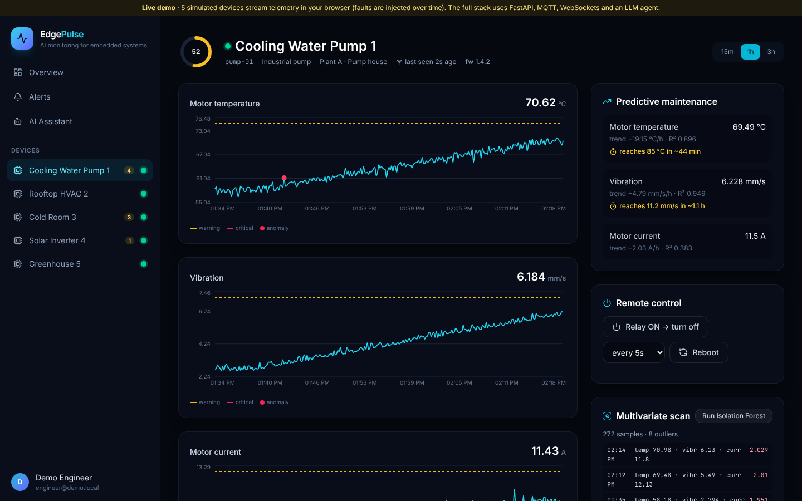
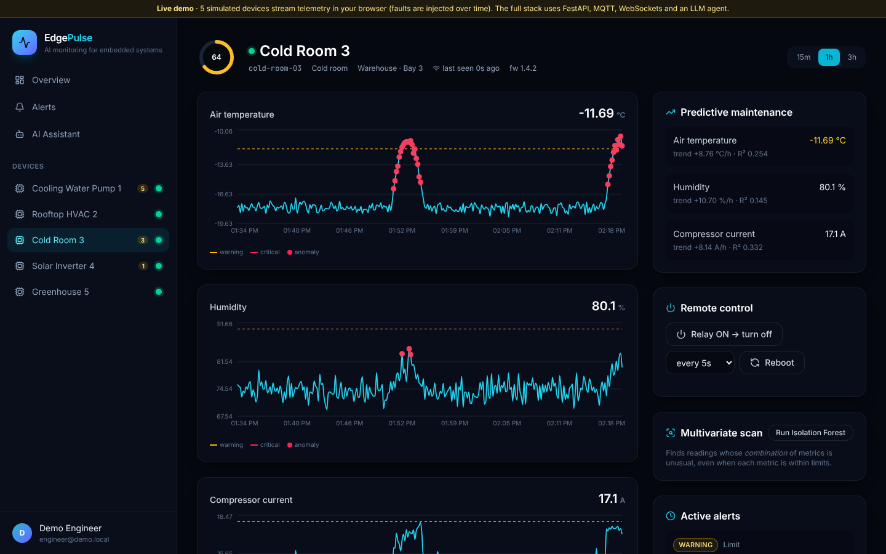
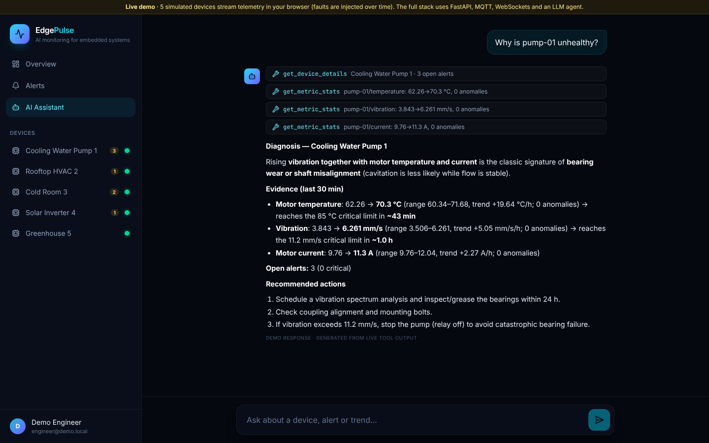
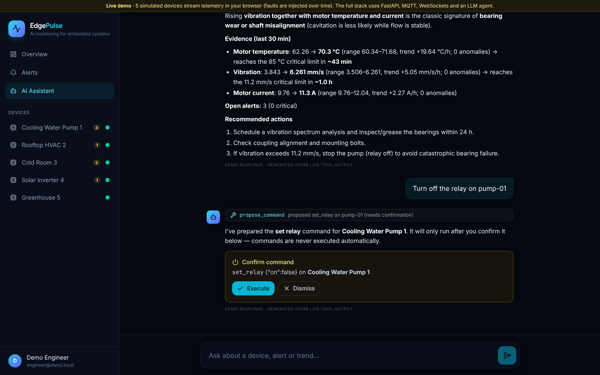
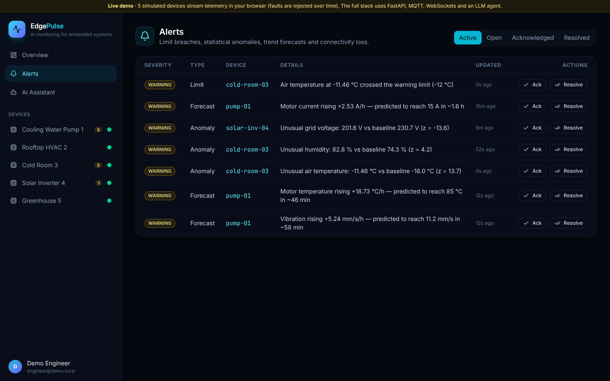
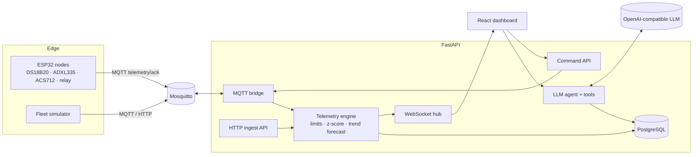

<div align="center">

# 📡 EdgePulse — AI IoT Monitoring for Embedded Systems

### Real-time telemetry, anomaly detection, predictive maintenance and an AI assistant for industrial IoT fleets

ESP32 nodes stream sensor data over **MQTT**. A FastAPI backend detects limit breaches, statistical anomalies and dangerous trends, pushes everything to a live **WebSocket** dashboard, and an **LLM agent** diagnoses equipment problems from the telemetry.

[](https://hanzalasqb.github.io/edgepulse-iot-ai/)




</div>

---

## ✨ Features

| | Feature | Details |
|---|---|---|
| 📶 | **Device ingestion** | MQTT (`edgepulse/<id>/telemetry`) and HTTP. Each device has its own API key (stored as a SHA-256 hash, compared in constant time) |
| ⚡ | **Real-time dashboard** | WebSocket push of telemetry, alerts, device status and command acks to every connected browser |
| 🚨 | **Limit monitoring** | Warning/critical limits per metric and device type. Alerts open, escalate and auto-resolve |
| 🧠 | **Streaming anomaly detection** | Rolling **modified z-score** (median/MAD, Iglewicz–Hoaglin), robust to the outliers it is hunting |
| 🌲 | **Multivariate scan** | **Isolation Forest** (scikit-learn) finds readings whose *combination* of metrics is unusual |
| 📈 | **Predictive maintenance** | Least-squares trend with R² predicts the *time until a critical limit* (e.g. "motor reaches 85 °C in ~43 min") |
| 🔌 | **Offline detection** | A watchdog marks silent devices offline. MQTT *last will* on the firmware side |
| 🤖 | **AI assistant** | Tool-calling LLM agent (fleet status, metric statistics, alerts, forecasts) that diagnoses root causes from real numbers |
| 🛑 | **Human-in-the-loop control** | Relay, sampling interval and reboot commands over MQTT or HTTP polling. The AI can only *propose* commands; the operator confirms them |
| 🔧 | **ESP32 firmware** | PlatformIO project: DS18B20 + ADXL335 + ACS712, RMS signal processing, auto-reconnect with back-off |
| 🧪 | **Fleet simulator** | 5 realistic device profiles with injectable faults: bearing wear, open cold-room door, grid voltage sags |

## 📸 Screenshots

| Device analytics + predictive maintenance | Anomaly detection (cold-room door events) |
|---|---|
|  |  |
| **AI diagnosis from live telemetry** | **AI-proposed command, operator confirms** |
|  |  |

<p align="center"></p>

## 🏗️ Architecture



**Telemetry pipeline:** reading → per-device key check → persist → limit check → modified z-score → periodic trend forecast → alert upsert/escalate/resolve → broadcast to dashboards.

## 🛠️ Tech stack

| Layer | Technologies |
|---|---|
| **Embedded** | ESP32, Arduino framework, PlatformIO, PubSubClient (MQTT), ArduinoJson, DallasTemperature |
| **Messaging** | MQTT (Eclipse Mosquitto), WebSockets |
| **Backend** | Python 3.12, FastAPI, SQLAlchemy 2.0, Pydantic v2, paho-mqtt, PyJWT, bcrypt |
| **ML / analytics** | NumPy, scikit-learn (Isolation Forest), robust statistics, linear regression forecasting |
| **AI** | OpenAI-compatible function calling (OpenAI, Groq, Ollama), streamed over SSE |
| **Frontend** | React 19, TypeScript, Vite, Tailwind CSS v4, Recharts |
| **DevOps** | Docker Compose (Mosquitto, Postgres, API, simulator, UI), GitHub Actions (tests, firmware build, Pages demo) |

## 🚀 Getting started

### One command (Docker)

```bash
git clone https://github.com/hanzalasqb/edgepulse-iot-ai.git
cd edgepulse-iot-ai
cp backend/.env.example backend/.env       # add LLM_API_KEY for the assistant
docker compose up --build
```

This starts Mosquitto, PostgreSQL, the API, a simulated fleet of 5 devices (with faults) and the dashboard at **http://localhost:3000**. API docs are at **http://localhost:8000/docs**.

### Local development

```bash
cd backend && pip install -r requirements.txt && cp .env.example .env
uvicorn app.main:app --reload                              # API on :8000
python ../simulator/simulate.py --backfill 30 --scenario demo   # stream fake devices
cd ../frontend && npm install && npm run dev               # UI on :5173
```

### Real hardware

Flash the [ESP32 firmware](firmware/README.md), provision the device (`POST /api/devices` returns its key once), then put the key in `firmware/include/secrets.h`.

## 🔌 API overview

| Method | Endpoint | Description |
|---|---|---|
| `POST` | `/api/ingest/{device_id}` | Device telemetry (header `X-Device-Key`) |
| `GET` | `/api/ingest/{device_id}/commands` | Command polling for HTTP-only devices |
| `GET` | `/api/fleet/summary` · `/api/devices` · `/api/devices/{id}` | Fleet KPIs, health, latest values, forecasts |
| `GET` | `/api/devices/{id}/telemetry?minutes=` | Down-sampled series with anomaly flags |
| `GET` | `/api/devices/{id}/anomaly-scan` | Isolation Forest scan |
| `GET/POST` | `/api/alerts` · `/api/alerts/{id}/ack` · `/resolve` | Alert workflow |
| `POST` | `/api/devices/{id}/commands` | Relay / interval / reboot |
| `POST` | `/api/assistant/stream` | AI agent (SSE: `tool_call`, `tool_result`, `proposal`, `token`) |
| `WS` | `/ws?token=` | Real-time event stream |

## 🧪 Testing

```bash
cd backend && pytest
```

The tests cover anomaly detection (noise vs. spike), forecasting accuracy, the Isolation Forest, device-key auth, the alert lifecycle (open → ack → auto-resolve), command queueing and acks, the offline watchdog, WebSocket auth and broadcast, and the AI agent's tool calls, including the rule that commands are only proposed, never executed. CI also compiles the ESP32 firmware with PlatformIO.

## 🌐 Live demo

The [live demo](https://hanzalasqb.github.io/edgepulse-iot-ai/) runs the same React app with an in-browser fleet simulator and a TypeScript port of the detection pipeline: limits, modified z-score, trend forecasts and alert lifecycle. Faults develop while you watch: the pump's bearings wear out, the cold-room door opens and the grid voltage sags. The AI assistant answers from the live numbers.

## 📁 Project structure

```
edgepulse-iot-ai/
├── backend/app/
│   ├── iot/          # telemetry engine, anomaly detection, forecasting, MQTT bridge, WebSocket hub
│   ├── agent/        # LLM tool-calling agent + tools
│   ├── routers/      # devices, ingest, alerts, commands, assistant, ws, auth
│   └── core/         # config, db, JWT, LLM client
├── simulator/        # fleet simulator with fault injection
├── firmware/         # ESP32 PlatformIO project
├── frontend/src/     # React dashboard (+ demo/ in-browser simulator)
├── mosquitto/        # broker config
└── docker-compose.yml
```

## 👤 Author

**Hanzala Saqib**, Full Stack AI Developer · [GitHub](https://github.com/hanzalasqb) · [LinkedIn](https://www.linkedin.com/in/hanzalasqb)

## 📄 License

MIT
